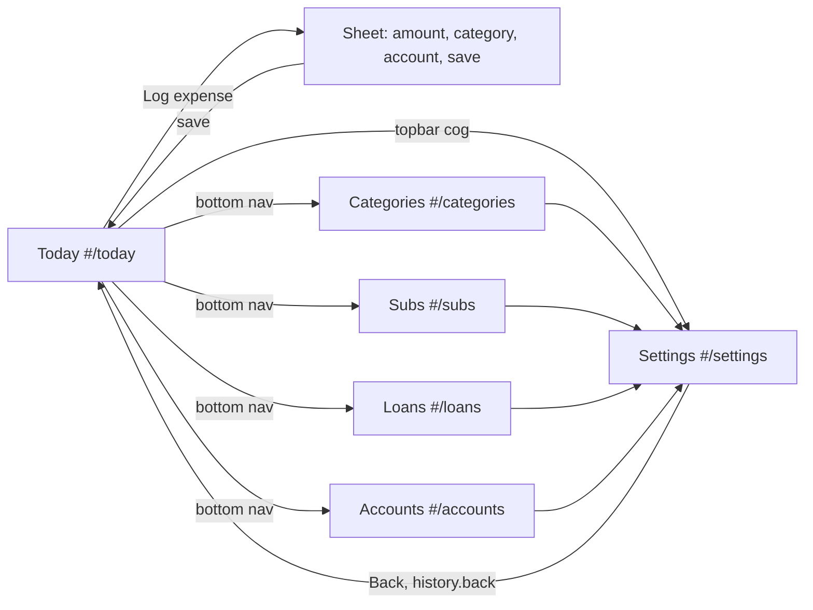

# UX: the four laws, applied

How stdynt applies Fitts's law, Hick's law, Jakob's law, and Miller's law, deliberately. Each claim names where it lives in the code. Visual specifics (palette, type, shapes) stay in `DESIGN.md`; this file maps the laws to the decisions.

## 1. Fitts's law: the target is where the thumb is, and big

- **Bottom nav, not top tabs.** Five tabs sit in the reach zone at the screen's foot (`MONEY_VIEWS`, `App.jsx:360`; `.bottom-nav`, `index.css`). Everything reached while walking is at the bottom.
- **One fixed primary action.** Log expense is a 56px pill pinned above the nav; while scrolling down it folds to a 56px round button at the bottom right (`DESIGN.md` "Phones (under 640px)"). It never moves out of reach.
- **48px tap targets everywhere.** Every control is 48x48px or larger; main actions are 56px (`index.css`: `.icon-btn`, `.row-del`, `.text-btn`, `.ledger-fold`, `.chip span`, `.radio-seg`, `.kind-seg`, `.sort-seg`, `.swatch`, `.settle`, `.swap-btn`, `.legend-link`, `.legend-btn`, `.toast-undo`, `.recent-pick`, `.filters-btn`, `.hfield`, `.pay-act`, `.plan-toggle`, `.inline-link`, `.cat-name`). 48px beats the Apple 44px convention on error rate; the user chose 48px.
- **Destructive targets sit at the row's end, with undo instead of a modal.** The delete X is the widest row cell (`.row-del`, 48px column in `.legend-btn`'s grid), and the danger is removed by a 5-second undo toast (`UNDO_MS = 5000`, `App.jsx:354`) rather than a confirm dialog. Distance from the accidental tap is covered by time, not friction.
- **Confirm slips only for what cannot be undone.** Restore backup, delete all data, and erase and start over confirm first; a deleted entry does not, because undo covers it (`App.jsx` restore/delete-all/erase slips).
- **The save button stays above the keyboard.** The sheet's footer is pinned (`.sheet-foot`), so the primary action never scrolls under `interactive-widget=resizes-content` (`index.html:5`).
- **No sticky hover.** Every hover style sits behind `(hover: hover) and (pointer: fine)` with `:active` fallbacks (`DESIGN.md` "Touch"), so a thumb always gets an answer and never gets a stuck state.

## 2. Hick's law: one decision per screen

- **One primary action per screen.** Log expense is the only filled 56px control on Today. Everything else is outline, text, or a fold.
- **Advanced settings fold away.** `Fold` (`App.jsx:616`) hides "More budget options" and "Edit loan details" behind one 48px row that carries a one-line summary while closed; from 1000px they open on their own so desktop users do not pay an extra click.
- **A smart default answers the hard question.** Budget setup offers "Use $X a day" (the remaining budget spread over the days left) with "Choose my own" as the second choice (`App.jsx:3265-3271`). Most users need zero decisions; the default is computed, not guessed.
- **Date and time are one line.** The sheet shows "Today, 14:32 · Change"; the fields stay in the form and open only when needed (`DESIGN.md` "Sheet on a phone").
- **First run is one decision.** No onboarding wizard: the Today card says what to do (set a budget) in plain text; until then the rest of the app still works.

## 3. Jakob's law: the patterns users already know

- **A bottom tab bar with exactly 5 items.** Today, Categories, Subs, Loans, Accounts (`MONEY_VIEWS`, `App.jsx:360-366`); Settings through the topbar cog. The count matches the 5-item convention.
- **Real navigation.** Views are `<a href="#/...">` hash routes with `aria-current="page"` (`App.jsx:3178`); browser back works, including a `popstate` handler for the sheet and history state (`App.jsx:1100-1149`). Settings' Back calls `history.back()` (`App.jsx:1100`).
- **Native controls, native dialogs.** The sheet and confirms are `<dialog>`; forms are real `button`, `input`, `select`, radio chips (`DESIGN.md` "Rules"). The share sheet is native `navigator.share` (`App.jsx:2879`).
- **The system respects its settings.** Five `prefers-reduced-motion` gates (`App.jsx:423`, `:448`; `index.css:1290`, `:3870`, `:4463`, and the `no-preference` wrappers), a dark-only `color-scheme` (`index.css:66`), safe-area insets (`--safe-b`), and `interactive-widget=resizes-content`.
- **Documented deviations.** Dark only: an owner identity decision recorded in `DESIGN.md` ("Theme"), not an oversight. Pull to refresh is off (`overscroll-behavior-y: contain`, `index.css:78`) on purpose: data is local and nothing ever refreshes from a network, so the gesture has nothing to do.

## 4. Miller's law: chunks with doors to the rest

- **Navigation is one chunk of 5.** See above.
- **The past folds away.** Today shows the last 7 days, then a fold for the rest (`App.jsx:3367`). History pages 10 days and 20 rows at a time (`HISTORY_DAYS_STEP`/`HISTORY_ROWS_STEP`, `App.jsx:654-655`), so the cap is a door, not a truncation.
- **Recents stop at 4.** The sheet's Recent row shows up to four past entries (`DESIGN.md` "Sheet extras").
- **The legend stops at 12.** The donut legend caps at 12 slices and labels (`App.jsx:3613`).
- **Context is carried forward.** Editing opens the sheet prefilled; the last category is remembered in `prefs.lastCategory` (`App.jsx:181`, applied at `:1522`) and the note field suggests past notes through a native datalist.
- **Recognition over recall.** Install shortcuts open Log expense, Accounts, and Loans directly (manifest); the budget line states in plain words what the number means ("$X a day lasts until [date]", `App.jsx:3260`).

### Conflicts, and what wins

| Conflict | Decision |
|---|---|
| Hick (fewer choices) vs Fitts (fewer, bigger targets) | Category chips scale with user-created categories, past 7 if needed. Users make their own categories; each chip is a 48px target. Choice wins where the choice is the user's own content. |
| Fitts 48px vs Apple's 44px convention | 48px wins (user decision). Error rate beats convention; nothing else in the design assumed 44. |
| Miller's 7 vs full history access | Pagination, not truncation. The cap organizes; the door keeps everything reachable. |

## 5. Information architecture

Six destinations: five tabs plus Settings. One primary flow, three characters deep, no screen without a visible way back.



Open, read one number, log an expense, watch the level move. Every other feature hangs off the tab it belongs to.

## 6. Wireframes

Thumb-zone bands: the bottom third is the primary zone, the middle is secondary, the top third is the ignore zone on a phone held in one hand.

**Today (360px phone):**

```text
+------------------------------------+
|  topbar: date          (cog) 48px  |   <- top third: glance only
+------------------------------------+
|  +------------------------------+  |
|  |  THE WELL                    |  |   <- one focal point:
|  |  $ left today  ####  level   |  |      the daily number
|  +------------------------------+  |
|  donut | legend (12 cap)           |   <- middle third: reading
|  7 past days ......... [fold 48px] |
|  +------------------------------+  |
|  |  History rows (48px rows)    |  |
|  +------------------------------+  |
+------------------------------------+
| [ Today ][ Cats ][ Subs ][ Ln ][ Ac]  <- bottom third: 48px tabs
|                        ( Log  )       56px pill / 56px round button
+------------------------------------+
```

**Log expense sheet (native dialog):**

```text
+------------------------------------+
|  grip ................. (drag down)|   <- closes with a flick
|  Today, 14:32 · Change             |   <- one line, not two fields
|  [ amount, 56px field ]            |
|  category chips (48px each) ...    |
|  Paid from: account chips ...      |
|  note field (datalist)             |
+------------------------------------+
|  [        Log expense, 56px   ]    |   <- pinned footer, above keyboard
+------------------------------------+
```

**Categories:**

```text
+------------------------------------+
|  topbar                  (cog)     |
+------------------------------------+
|  donut | legend buttons (48px rows)|   <- each row: name, spent, 48px X
|  cat head | cat head |  (36px gap) |
|  +------------------------------+  |
|  | rows: name, budget, delete X |  |   <- X is the widest cell
|  +------------------------------+  |
|  [ Add category, full width ]      |
+------------------------------------+
| [ nav, 48px tabs ]                 |
+------------------------------------+
```

**Settings:**

```text
+------------------------------------+
|  topbar: <- Back (48px)   (no cog) |   <- Back is the only way out
+------------------------------------+
|  Budget card                       |
|    daily budget field (48px)       |
|    [More budget options, 48px fold]|
|  Backup card: Back up / CSV /      |
|    Restore (all 48px+, confirm)    |
|  Install card (or steps on iOS)    |
|  Data: erase and start over        |
|    (confirm slip, red)             |
+------------------------------------+
| [ nav, 48px tabs ]                 |
+------------------------------------+
```

## 7. Technical plan

- **Service worker** (`public/sw.js`): at install, every built file is precached with `cache: 'reload'` (all-or-nothing), and the app thereafter opens cache-first, never from the network. The file list and a content hash are injected at build time by the `precacheManifest` plugin in `vite.config.js`; any changed file changes `sw.js`, which is the update signal. A new build downloads in the background and takes over the next time the app backgrounds, never mid-sheet, mid-undo, or mid-typing. Navigation falls back to the shell (`index.html`).
- **Data** (`App.jsx:158`, `makeDefaultState`): one localStorage key, `stdynt_data_v1`. Every write is local and durable at write time. There is no sync and no server, so there is no offline write queue: a queue would hold writes that are already saved, which is dead code by definition.
- **Privacy:** nothing leaves the device. Exports go through the native share sheet (JSON backup, CSV). Restore quarantines the incoming file and confirms before it replaces anything. Data that cannot be parsed is moved aside to `stdynt_data_v1_unreadable` with a persistent red slip that offers "Restore backup" and "Erase and start over" (`DESIGN.md` "Storage errors").
- **Implementation status:** everything above exists in this repo. The only delta from the audit: all 44px tap targets were raised to 48px (one commit, `src/index.css`, plus the matching numbers in `DESIGN.md`).

## 8. Accessibility checklist

Contrast measured (WCAG, all pass AA for normal text):

| Pair | Ratio | AA (4.5:1) |
|---|---|---|
| `--text` `#f5f0e6` on `--panel` `#1e3b2f` | 10.74:1 | pass |
| `--text-2` `#b5bda4` on `--panel` `#1e3b2f` | 6.26:1 | pass |
| `--sun` `#c8b48a` on `--panel` `#1e3b2f` | 6.01:1 | pass |
| `--red` `#ee7d6f` on `--panel` `#1e3b2f` | 4.53:1 | pass |
| `--placeholder` `#98a584` on `--field-bg` `#172d24` | 5.60:1 | pass |

- [ ] Focus ring visible everywhere: cream ring on every surface; rows draw it inside; the amount field on `:focus-within`.
- [ ] `aria-current="page"` on the active tab (`App.jsx:3178`).
- [ ] Live messages in always-mounted `role="status"` regions (`DESIGN.md` "Rules").
- [ ] History search labelled for screen readers; icons `aria-hidden` beside a visible or `aria-label` name.
- [ ] `lang="en"` in `index.html`; tabular figures for money.
- [ ] Reduced motion respected (five gates, `App.jsx`/`index.css`); reduced transparency and dark `color-scheme` set.
- [ ] 48x48px tap targets; 56px main actions.
- [ ] Keyboard: native controls and native `<dialog>`, so Tab, Enter, and Escape work without script.

## 9. QA checklist

- [ ] **Airplane mode:** serve `dist/`, open once online, kill the server, reload. The app opens from the SW cache and every view renders. Fail: a network request blocks first paint.
- [ ] **Install (Android Chromium):** open, menu, Install; launch from the icon. `#/today` opens standalone; the "Log expense" shortcut opens the sheet. Fail: browser chrome visible or wrong start route.
- [ ] **Install (iOS):** Share, Add to Home Screen; launch from the icon. Standalone with status bar styling per the meta tags. Fail: Safari chrome visible.
- [ ] **Low storage:** fill the origin's quota (DevTools or a large seeded state). Writes fail into the persistent slip path, nothing is silently lost, and saving resumes when space frees. Fail: a silent throw or lost rows.
- [ ] **One-handed reach:** at 360px, every primary action (Log expense, nav, sheet save, row delete X, undo) sits in the bottom third. Fail: any primary action above the fold line that must be tapped while holding the phone.
- [ ] **5-second comprehension:** show each of the six screens to a cold reader for 5 seconds; the reader can name what the screen does and what the primary action is. Fail: any screen the reader cannot name.
